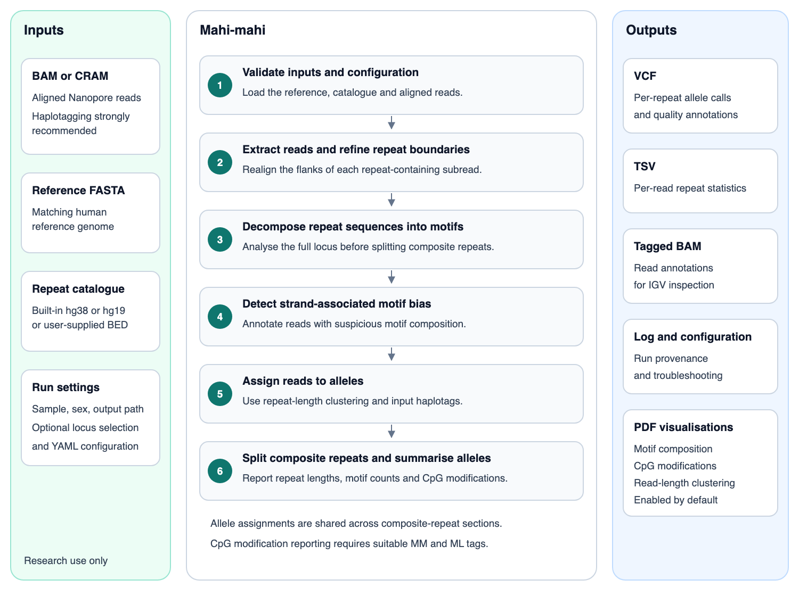
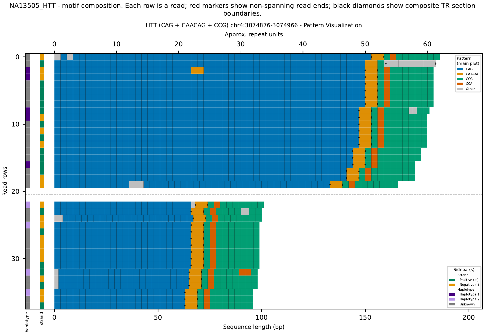
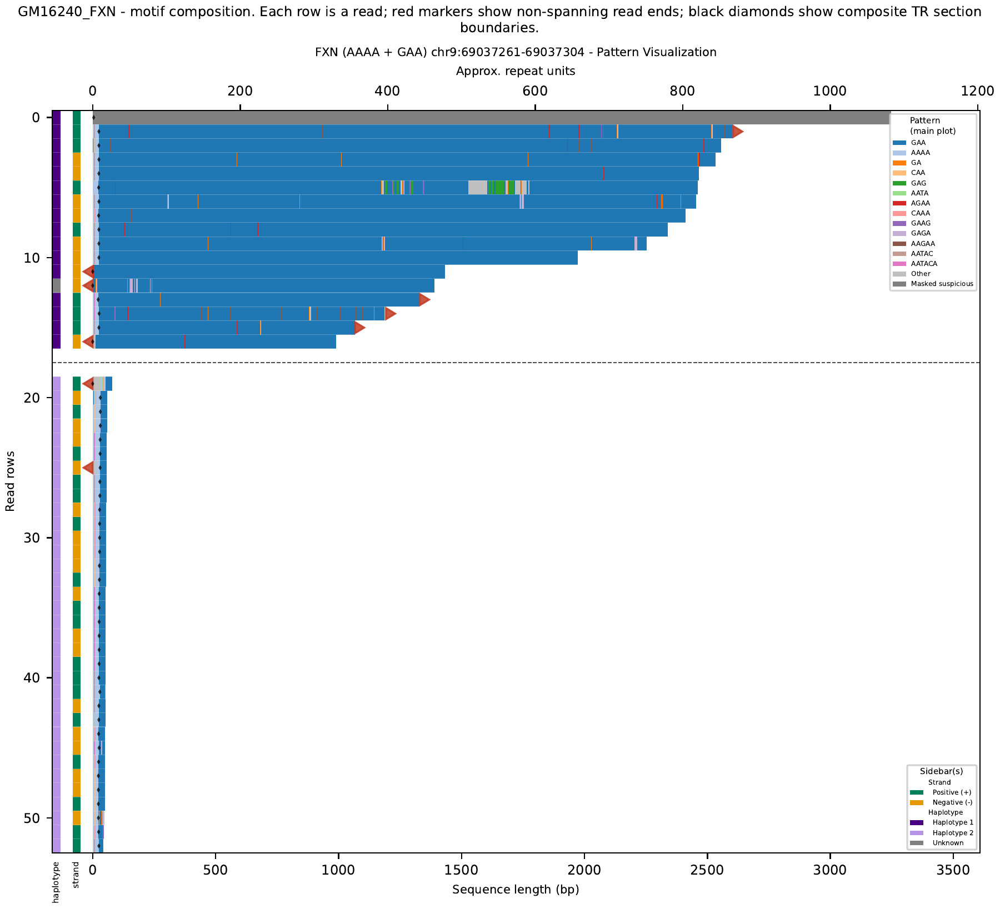
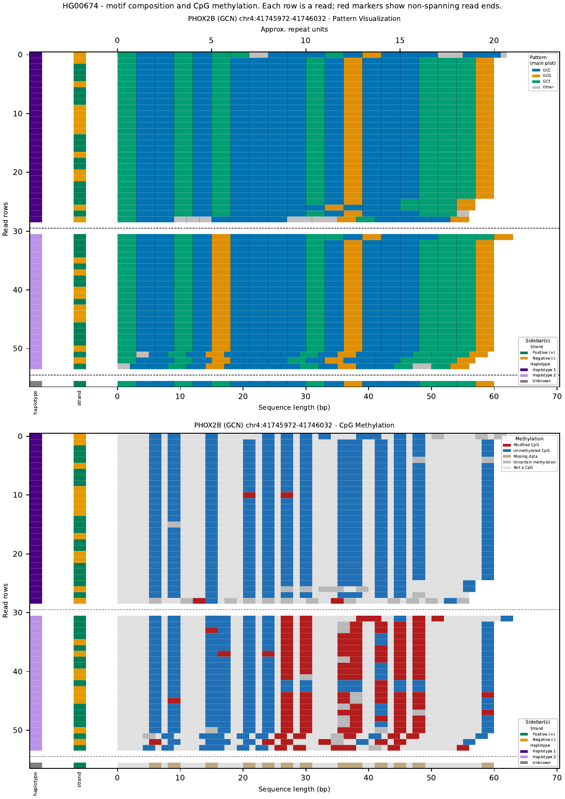
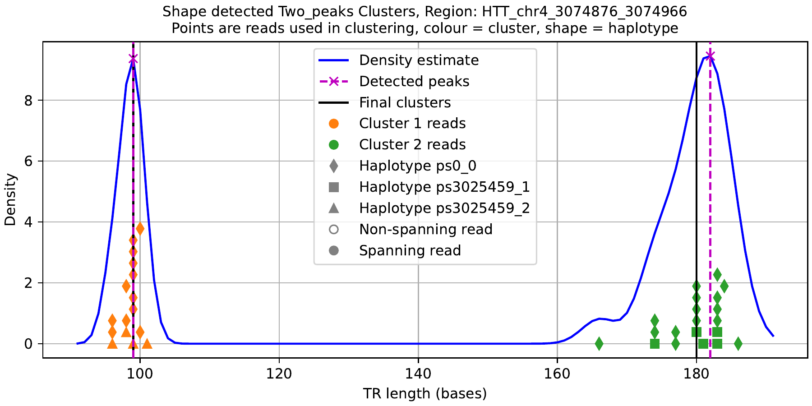
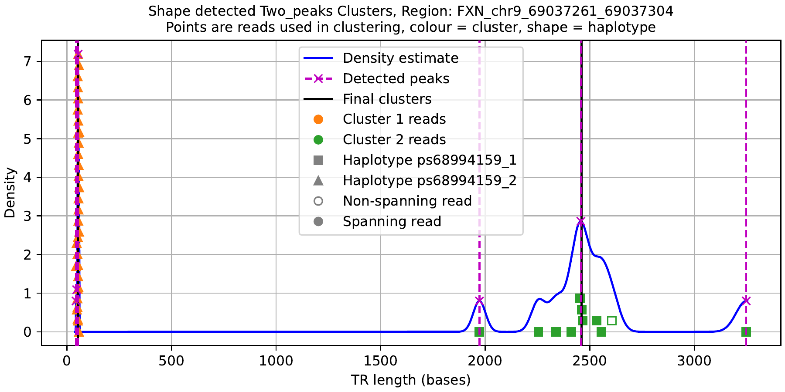

# Mahi-mahi

**FOR RESEARCH USE ONLY**

License: [Oxford Nanopore Technologies PLC. Public License, v. 1.0](LICENSE.md)

Oxford Nanopore Technologies PLC

Gosling Building, Edmund Halley Road, Oxford Science Park, Oxford, OX4 4DQ, UK

Contact: <https://nanoporetech.com>

## Disclaimer

Oxford Nanopore Technologies, the Wheel icon, AMPORE-TB, EPI2ME, GridION, MinION, MinKNOW, PromethION, P2 Solo, and P2 are registered trademarks or the subject of trademark applications of Oxford Nanopore Technologies plc in various countries. Information contained herein may be protected by copyright, patents or patents pending of Oxford Nanopore Technologies plc. All other brands and names contained are the property of their respective owners. Oxford Nanopore Technologies products are RUO. Products labelled/branded as Oxford Nanopore Diagnostics may be RUO or may be regulated as in-vitro diagnostic devices in some jurisdictions, please check individual product labelling.

ONT plc is a member of the producer compliance scheme run by ERP UK Ltd, who manage the submission of documentation in support of WEEE compliance for ONT plc’s manufacture and supply of Electrical and Electronic equipment in the UK.

ONT’s WEEE PRN is WEE/MM3828AA.

## Contents

-   [Introduction](#introduction)
-   [Scope and Intended Use](#scope-and-intended-use)
-   [System Requirements](#system-requirements)
-   [Installation](#installation)
-   [Operating Instructions](#operating-instructions)
-   [Inputs](#inputs)
-   [Output files](#output-files)
-   [Warnings, Precautions, and Limitations](#warnings-precautions-and-limitations)
-   [Security Considerations](#security-considerations)
-   [Troubleshooting and Support](#troubleshooting-and-support)
-   [Decommissioning](#decommissioning)
-   [Glossary and Acronyms](#glossary-and-acronyms)
-   [Change History](#change-history)

# Introduction



Mahi-mahi is a command-line bioinformatics tool for analyzing tandem repeat loci from long-read nanopore sequencing data. It is designed for short tandem repeat genotyping in cases where repeat lengths may vary across reads, including unstable or somatically expanding repeats, and it supports both simple and more complex repeat structures. At a high level, Mahi-mahi takes aligned sequencing reads together with a reference genome and a repeat catalogue, extracts the reads overlapping each target locus, refines repeat boundaries, decomposes the repeat sequence into motifs, and groups reads into allele-level summaries. It produces per-allele variant calls in VCF format, per-read statistics in TSV format, and a tagged BAM that can be inspected in tools such as IGV.

Mahi-mahi is run as a local command-line tool, typically by a bioinformatics workflow, pipeline runner, or technical user (bioinformatician). In practice, it is likely executed inside an analysis environment where a workflow passes in BAM or CRAM files, a reference genome, a repeat catalogue, and output paths, then collects the resulting VCF, TSV, tagged BAM, and logs.

# Scope and Intended Use

Mahi-mahi is intended for research use on nanopore sequencing data for analysis of tandem repeat loci.

1.  It is intended for users who are comfortable working with BAM or CRAM files, reference genome FASTA files, BED-based repeat catalogs, and command-line bioinformatics software.

2.  R10 chemistry is required. For basecalling using MinKNOW, models v5.2 HAC or SUP are supported. The PromPlus v5.2 HAC model is also supported and gives equivalent performance to other PromethION flowcells. Output from Dorado v2.0 (v6 basecalling) is also supported.

3.  Mahi-mahi is intended for use with:

    -   Aligned BAM or CRAM input. Haplotagged files are strongly recommended; the haplotagged files generated by wf-human-variation are ideal.
    -   Reference genome FASTA files matching the selected loci file
    -   Built-in STR loci sets loaded with `--loci hg19` or `--loci hg38`, or user-supplied BED files
    -   Mahi-mahi supports non-haplotagged input only when `--bypass-haplotag-check` is used. Caution: this might result in merging close-in-length alleles (typically less than 6 bp difference), and may more generally reduce accuracy.

# System Requirements

## Software requirements

-   Python \>=3.10, \<3.13

-   pip


Package dependencies include:

-   numpy\>=1.25, \<3.0

-   pysam\>=0.22, \<1.0

-   scikit_learn\>=1.3, \<2.0

-   trviz==1.4.2

-   matplotlib\>=3.7, \<4.0

-   pydantic\>=2.12, \<3.0

-   pandas\>=2.0, \<3.0

-   PyYAML\>=6.0

-   ont-parasail==1.3.4

## Compute resource requirements

Mahi-mahi is intended to run on a standard local workstation or managed compute node. Since only a small set of loci are analysed, system requirements are low. Any system capable of analysing genome sequencing data will be sufficient (multi-core CPU with 16 GB of memory or more). Runtime on a standard system and with standard read depth and loci list should not exceed 10 minutes.

## IT and access requirements

Users require permission to install Python packages in their environment and write access to the chosen output directory.

The software is command-line based and intended to run on a local or managed compute environment appropriate for bioinformatics analysis.

# Installation

Python and pip must be available before installation. Internet access is required to download the release files and any dependencies not already installed in your environment.

We recommend installing Mahi-mahi in an isolated Python environment to avoid conflicts with other software. For example, on Linux or macOS, using a supported Python version:

``` bash
python3 -m venv mahi-mahi-env
source mahi-mahi-env/bin/activate
python -m pip --version
```

The software is distributed together with:

-   the wheel file

-   this README

-   the versioned minimal install-check package, for example `mahi-mahi-hg002-chr18-tcf4-v0.7.1.tar.gz`

Install from the supplied wheel file. Do not rename the wheel file, as pip requires its original filename:

``` bash
python -m pip install ./mahi_mahi-<version>-py3-none-any.whl
```

If you are working from a repository checkout instead of a release bundle, install from the repository root:

``` bash
python -m pip install .
```

## Installation notes

The software installs the following command-line tools:

-   mahi-mahi

-   mahi-mahi-loci-tools

Mahi-mahi includes built-in STR loci BED files that are loaded with `--loci hg38` or `--loci hg19`.

## Installation Verification

Download the install-check archive for your version from the [GitHub releases](https://github.com/nanoporetech/mahi-mahi/releases). For example, the archive for v0.7.1 is mahi-mahi-hg002-chr18-tcf4-v0.7.1.tar.gz.

The install check contains:

-   a single-locus HG002 TCF4 test case

-   a chr18-only reference bundle

-   an expected VCF

-   an expected-version file generated from the package version

-   a verify-mahi-mahi-installation.sh script

To run the install check:

``` bash
tar -xzf mahi-mahi-hg002-chr18-tcf4-v0.7.1.tar.gz
cd mahi-mahi-hg002-chr18-tcf4
./verify-mahi-mahi-installation.sh
```

If the installation is working, the script ends with:

``` text
PASS: mahi-mahi install check completed successfully.
```

The script checks that:

-   mahi-mahi on PATH

-   the installed version reported by `mahi-mahi --version` matches the package version

-   mahi-mahi exits successfully

-   output/chr18_TCF4.vcf exists

-   output/chr18_TCF4.vcf is byte-for-byte identical to expected/chr18_TCF4.vcf

# Operating Instructions

## Command-line usage

``` text
usage: mahi-mahi [-h] [--version] [-c CONFIG] [--profile PROFILE] [--set KEY=VALUE] (--bam BAM | --cram CRAM) --ref REFERENCE_GENOME_FASTA --loci BED
                 [--repeat-id REPEAT_ID] --sample SAMPLE --sex {XX,XY} -o OUT_DIR [--no-clustering] [--debug] [--bypass-haplotag-check]

options:
  -h, --help            show this help message and exit
  --version             show the mahi-mahi version and exit
  -c CONFIG, --config CONFIG
                        Path to mahi-mahi YAML config file. Defaults to the built-in file shipped with mahi-mahi.
  --profile PROFILE     Named config profile to apply after defaults.
  --set KEY=VALUE       Override a config value; repeat for multiple overrides.
  --bam BAM             BAM file
  --cram CRAM           CRAM file
  --ref REFERENCE_GENOME_FASTA
                        Reference genome file (FASTA format)
  --loci BED            BED file with STR loci, or built-in STR loci shortcut (hg19 or hg38)
  --repeat-id REPEAT_ID
                        Repeat ID to analyze (omit to analyze all repeats in --loci)
  --sample SAMPLE       Sample name to use in output VCF file, and as the stem of every output filename.
                        Must be a simple filename stem: only letters, digits, '.', '@', '_' and '-' are allowed,
                        it must start with a letter or digit, and it cannot contain path separators or '..'.
  --sex {XX,XY}         Sex of sample
  -o OUT_DIR, --out-dir OUT_DIR
                        Path to output directory
  --no-clustering       Turns off clustering of reads into two alleles based on read alignment length,
                        and instead uses existing haplotypes only
  --debug               Enable debug messages for detailed logging
  --bypass-haplotag-check
                        Accept non-haplotagged input. Caution: will result in merging close-in-length alleles,
                        and may more generally reduce accuracy
  --overwrite           Allow --out-dir to be non-empty, overwriting any existing mahi-mahi output in it

Research use only. Not for use in diagnostic procedures.
```

All files written by Mahi-mahi are placed directly below the resolved `--out-dir`; nothing is
written outside it. To avoid overwriting existing results, `--out-dir` must either not exist yet or
be empty; otherwise Mahi-mahi exits with an error before doing any analysis. Choose a new
`--out-dir`, delete the existing output, or pass `--overwrite` to continue.

## Example run

``` bash
mahi-mahi \
  --bam sample.bam \
  --ref reference.fasta \
  --loci hg38 \
  --sample SAMPLE \
  --sex XX \
  --out-dir out
```

## Configuration

The config is a YAML file with parameters that control tool behaviour. If you do not pass `--config`, Mahi-mahi loads the embedded defaults. Custom config files override those defaults.

Config parameters can also be overridden from the command line with repeated `--set KEY=VALUE` options, for example:

``` bash
mahi-mahi ... --set min_read_support_per_allele=6
```

### Key configuration parameters

Below is an explanation of the key config values:

For a fuller configuration reference, including strand-bias and ABA-composite settings, see [docs/CONFIG.md](docs/CONFIG.md).

| Parameter                               | Description                                                                                                                                                                                                                                                                                                         |
|------------------------------------|------------------------------------|
| extension                               | The number of bases to extend on both sides of the region when processing reads. Default: 150. Note that the extension is not included in the calculation of the repeat copy number.                                                                                                                                |
| min_flank_length                        | If a read does not initially map to both sides of the region, search again with shorter flanking sequences, until either it does map or this minimum length is reached. Default: 75. Reads that still do not map to both sides will be treated as non-spanning.                                                     |
| max_flank_length                        | After shorter flanks fail to realign, try one longer flank, capped at this length and at the available read-side length. Default: 1000. The longer-flank attempt is skipped when its length would not exceed `extension`.                                                    |
| region_merge_distance                   | The minimum distance allowed between loci that do not touch. Default: 50. (Loci that do touch are merged into a single composite TR.)                                                                                                                                                 |
| min_region_coverage                     | The minimum number of reads required to consider a region valid for analysis. Default: 10. Regions with fewer reads will be flagged as FILTER=LowDepth.                                                                                                                                                             |
| min_read_support_per_allele             | Minimum read support for accepting haplotags for each allele and avoiding FILTER=LowDepth. Default: 4. Also sets the minimum total number of selected reads needed to attempt clustering; it does not set the per-cluster minimum, which is fixed at 3 reads. Other clustering criteria also apply. |
| include_extra_trs                        | Whether to include non-pathogenic parts of multi-TR loci as separate VCF records. Default: true.                                                                                                                                                                                                                |
| generate_clustering_plots               | Whether to write per-locus read-length KDE clustering PDFs to OUT_DIR/SAMPLE_plots/. Default: true.                                                                                                                                                                                                              |
| generate_motif_plots                    | Whether to write static per-locus motif-composition PDFs to OUT_DIR/SAMPLE_plots/. Default: true.                                                                                                                                                                                                                |
| generate_methylation_plots              | Whether to add a CpG methylation panel below the motif panel in those PDFs. Ignored unless generate_motif_plots is also true. Default: true.                                                                                                                                                                        |
| methylation_state_confidence_threshold  | Minimum probability for a CpG state to be reported as valid. Lower-confidence states are marked as uncertain and excluded from methylation summaries. Default: 0.80.                                                                                                                               |
| very_wide_cluster_minimum_q75_q50_ratio | Very variable-length alleles, defined as alleles with (75th percentile / 50th percentile) of at least this, use their 75th percentile as their length. This is intended to make it more obvious that the sample has some very long TRs here. Default: 2.0. To turn this feature off entirely, set this to Infinity. |

# Inputs

A mahi-mahi analysis requires aligned reads, a matching reference genome, a tandem repeat catalogue, and additional arguments used to control the analysis run.

| Input                  | What it is                                                    | Notes                                                                                                                                                                                                                                                                  |
|------------------------|------------------------|------------------------|
| BAM or CRAM file       | File containing mapped nanopore sequencing reads              | Ideally haplotagged, i.e. output from wf-human-variation, but also accepts files without haplotagging such as merged and aligned BAM output from MinKNOW. Note: use this parameter from wf-human-variation to get BAM rather than CRAM as output: --output_xam_fmt BAM |
| FASTA file             | Human reference genome                                        | Human reference genome (hg38 or hg19). Must match the BAM file and the BED file, i.e. use the same coordinate system.                                                                                                                                                  |
| BED file               | Built in for hg19 or hg38, or a user-defined BED file         | Specifies the tandem repeat regions to be analysed.                                                                                                                                                                                                                    |
| Config YAML (optional) | YAML file with parameters that control tool behaviour         | Custom config files override embedded defaults.                                                                                                                                                                                                                        |
| Additional arguments   | Arguments affecting output file locations and sample metadata | Includes --sample, --sex, --out-dir, and optional locus filters such as --repeat-id.                                                                                                                                                                                   |

## Reference fasta

The input FASTA file provides the reference genome sequence used for the read alignments and locus definitions. The reference FASTA must match the genome build used by the BAM or CRAM file and the selected loci catalogue, for example GRCh38/hg38 or GRCh37/hg19. Note that support for hg19 has not been fully verified.

The reference FASTA must be indexed: a matching `.fai` file must exist alongside it, otherwise Mahi-mahi exits with an error.

## BAM / CRAM

The input BAM or CRAM file contains the aligned nanopore sequencing reads for the sample to be analysed. Haplotagged input is expected and recommended, as haplotags improve separation of nearby alleles; non-haplotagged input can be used only with --bypass-haplotag-check, with reduced accuracy expected in some cases. Each read must have both `PS` (phase set) and `HP` (haplotype) tags, or neither; a read with only one tag triggers a validation error.

The file must be coordinate-sorted and indexed: a matching `.bai` (or `.crai` for CRAM) file must exist alongside it, otherwise Mahi-mahi exits with an error. The alignments should match the same reference build as the loci BED file and reference FASTA.

## Loci BED file

The loci BED file specifies the tandem repeat regions to be analyzed.

Mahi-mahi includes built-in STR loci BED files that are loaded with `--loci hg38` or `--loci hg19`. Use the version that matches the reference genome you pass to `--ref`.

The built-in hg38 catalogue is the primary catalogue verified for mahi-mahi. A built-in hg19 catalogue is also distributed for compatibility, but hg19 support has not been extensively verified for this release.

You may also create your own BED files:

1.  If starting from a Stranger/ExpansionHunter JSON file, for example from gnomAD or STRchive, run `mahi-mahi-loci-tools convert <loci.json> <loci.bed> <reference_genome.fasta>`. Read any warnings it outputs: it is intended to provide a first draft that will often require manual fixup, not a finished `.bed` file.

2.  If creating loci manually, see [BED file format](#bed-file-format) below.

3.  Check your new loci by running `mahi-mahi-loci-tools check <loci.bed> <reference_genome.fasta>`. See below for more information on issues it might find. In particular, in mahi-mahi composite TRs must be in the given order and part-motifs on boundaries are rounded up, which locus definitions intended for other tools may not expect.  If you prefer to not include part-motifs on boundaries, you can remove them with `mahi-mahi-loci-tools trim-boundaries <loci.bed> <trimmed_loci.bed> <reference_genome.fasta>`.

5.  To run Mahi-mahi with your new loci, pass `--loci <loci.bed> --ref <reference_genome.fasta>`.

Run `mahi-mahi-loci-tools --help` for more information on this tool.

### BED file format

Each non-comment row of the BED file represents one TR. It may also include comment rows, starting with #, which are ignored. The rows may be in any order. The default BED files are sorted by position, but this is not required.

It must have the following columns, separated by tabs:

| Column Name | Description                                                                                               |
|------------------------------------|------------------------------------|
| chrom       | Chromosome name                                                                                           |
| start       | Start position of the repeat region in the reference genome                                               |
| end         | End position of the repeat region. end == start is allowed for TRs that have zero copies in the reference |
| motif       | Expected repeat motif(s), in reference orientation                                                        |
| repeat_id   | Identifier for the repeat region, which may include more than one TR                                      |
| variant_id  | Identifier for the individual TR; must be unique across the BED file. Copied to the REPID output field.    |

The columns must be in this order. The column headers included by default are a comment for the convenience of human readers, and are not actually used by Mahi-mahi.

For single TRs, as opposed to composite TRs, normally repeat_id == variant_id.

### TR boundary definitions

-   The copy number of a TR depends on the choice of start and end coordinates, so if this copy number is being compared to something external, such as a pathogenicity threshold, and small differences matter, it is important to use consistent definitions.

    -   `mahi-mahi-loci-tools compare` may be useful for checking this.

    -   If the region boundary does not align with the motif boundary, Mahi-mahi will usually count the partial motif at the boundary as a full motif in `<STRn>` / `REPCN`, but count it as a different motif in `MRCN`.

-   If a TR region contains sequence that is not actually repetitive, the motif decomposition of this unexpected sequence may be effectively nonsensical. Hence, the reported total copy number will be increased, but not necessarily by (extra sequence length / given motif length). The reported length in bases is still meaningful.

    -   Repetitive roughly means that most, but not necessarily all, of the copies are exact repeats from some small set of motifs. Hence, Mahi-mahi is only suitable for STRs, not for long-motif TRs where most copies contain at least one difference, sequencing error and/or real mutation.

-   The flanking sequences, the extension bases on each side of the TR, must be mappable enough that they can be correctly identified.

    -   In particular, if another SV, including another STR, is close to this TR, then the TR may either not be found at all, or be found with the boundary on the wrong side of the other SV, and hence with an incorrect length. Hence, adjacent TRs should always be specified as a composite TR or mixed-motif TR, see below, even if you only care about one of them.

    -   Loci with close paralogs may miss one or both alleles of the TR because this allele's reads have been wrongly mapped to another paralog, or may report extra alleles because another paralog's reads have been mapped to this locus. NOTCH2NLC, NUTM2B-AS1 and GOLGA8A can be affected by this issue.

    -   These flanking sequences must be correct in the reference genome used. XYLT1 is excluded from the default set because they are not.

### Composite TRs and mixed-motif TRs

Mahi-mahi has two ways to describe TRs with more than one motif: composite TRs and mixed-motif TRs. The default set includes some of both.

Composite TRs:

-   Are specified as two or more lines in the BED file, with adjacent coordinates and the same repeat_id, but different variant_ids, and one motif each. Example:

``` text
chr13    70139353    70139383    CTA    ATXN8OS    ATXN8OS_CTA
chr13    70139383    70139428    CTG    ATXN8OS    ATXN8OS
```

-   Are ordered: some number of motif As, then some number of motif Bs. Every part of the composite TR will be assigned to one of the individual sub-TRs, with the boundaries placed to make each section resemble its expected motif as much as possible.

    -   This is likely to produce nonsensical results if the structure is not the expected one, blocks in a different order, or a block that is not any of the expected motifs. If the expected-motif count, in `MRCN`, of some block is much lower than its overall count, `<STRn>`, then this may have happened.

    -   For 3-part motifA / motifB / motifA composites whose middle sub-TR is the main sub-TR, the one with `variant_id == repeat_id`, Mahi-mahi also runs an additional check of the middle segment. If it has too few exact matches to its expected motif, Mahi-mahi collapses the decomposition to the trivial left-only split. Set `aba_middle_exact_fraction_threshold` to `0` in the config file to disable this check.

    -   Sub-TR lengths can be zero, i.e. potentially missing blocks are OK.

    -   To represent one run of motif Bs somewhere in a stretch of motif As, use 3 parts: motif A then motif B then motif A. Example:

``` text
chr16    24613440    24613479    TTTTA    TNRC6A    TNRC6A_TTTTA_5P
chr16    24613479    24613479    TTTCA    TNRC6A    TNRC6A
chr16    24613479    24613528    TTTTA    TNRC6A    TNRC6A_TTTTA_3P
```
-   Output a separate VCF line for each sub-TR when `include_extra_trs` is true, or only the main sub-TR when it is false, with a \<STRn\> count of only that sub-TR. The main sub-TR is the one whose variant_id does not end with a motif-like suffix, for example ATXN8OS and TNRC6A in the above examples. Motif-like suffixes include IUPAC ambiguity codes, optional trailing digits, and optional `_3P`/`_5P` side labels.

    -   Stranger annotates only sub-TRs whose identifiers are present in its catalogue, regardless of `include_extra_trs`. Other components are ignored with a warning. Annotation requires repeat definitions and thresholds appropriate to the recognised sub-TR.

Mixed-motif TRs:

-   Are specified as a single line in the BED file with multiple motifs. These motifs can be given as IUPAC ambiguity codes, for example GMA, and/or as a comma-separated list, for example GAA,GCA.

-   Are unordered: the motifs can be mixed together in any order. In particular, this allows alternating structures, e.g. GAA,GCA will match (GCAGAAGAA)n and count it as 2n GAAs and n GCAs, while a GCA then GAA composite TR would place essentially all of it in the GAA section because that motif is the majority motif.

-   Output a single VCF line for the whole TR, with a \<STRn\> count for the whole TR. Counts for each motif are available in MRCN.

    -   Stranger looks at \<STRn\>, not MRCN, so in cases where only some of the motifs are pathogenic, it may misclassify a long benign allele as pathogenic.

Example mixed-motif representation:

``` text
chr4    39348424    39348479    AAGGG,ACAGG,AGGGC,AAGGC,AGAGG,AAAAG,AAAGG,AAGAG,AAAGGG    RFC1    RFC1
```

### Built-in hg38 catalogue

The built-in hg38 catalogue contains the following loci.

| Locus     | Locus   | Locus       | Locus      | Locus   |
|-----------|---------|-------------|------------|---------|
| ABCD3     | C9ORF72 | FXN         | NOP56      | TBP     |
| AFF2      | CACNA1A | GIPC1       | NUTM2B-AS1 | TBX1    |
| AFF3      | CBL     | GLS         | PABPN1     | TCF4    |
| AR        | CNBP    | GOLGA8A     | PHOX2B     | THAP11  |
| ARX_EIEE  | COMP    | HOXA13-I    | PPP2R2B    | TNRC6A  |
| ARX_PRTS  | CSTB    | HOXA13-II   | PRDM12     | TYMS    |
| ATN1      | DAB1    | HOXA13-III  | PRNP       | VWA1    |
| ATXN1     | DIP2B   | HOXD13      | RAI1       | YEATS2  |
| ATXN10    | DMPK    | HTT         | RAPGEF2    | ZFHX3   |
| ATXN2     | EIF4A3  | JPH3        | RFC1       | ZIC2    |
| ATXN3     | EP400   | LRP12       | RILPL1     | ZIC3    |
| ATXN7     | FAM193B | MARCHF6     | RUNX2      | ZNF713  |
| ATXN8OS   | FGF14   | MIR7-2      | SAMD12     |         |
| BCLAF3    | FMR1    | NAXE        | SOX3       |         |
| BEAN1     | FOXL2   | NIPA1       | STARD7     |         |

See <https://strchive.org/loci/> for background information on these loci. This does not imply that Mahi-mahi uses the STRchive repeat boundaries: the BED file supplied with the selected Mahi-mahi release defines the intervals and motifs used for analysis. Repeat counts and pathogenicity thresholds depend on those definitions; only apply thresholds compatible with the analysed interval and motif representation.

# Output files

All outputs are written to the specified OUT_DIR.

The main outputs are:

| File                        | Description                                                                |
|------------------------------------|------------------------------------|
| OUT_DIR/SAMPLE.vcf          | Tandem repeat variant calls (uncompressed VCF)                             |
| OUT_DIR/SAMPLE.tsv          | Per-read statistics (tab-separated values)                                 |
| OUT_DIR/SAMPLE.tagged.bam   | BAM file with tagged reads used in genotyping                              |
| OUT_DIR/SAMPLE.config.yaml  | Resolved config used for the run                                           |
| OUT_DIR/SAMPLE_plots/ | Per-locus clustering and motif-composition PDFs, when the corresponding plot options are true |
| OUT_DIR/SAMPLE.log          | Run log                                                                    |

The VCF contains tandem repeat variant calls with custom INFO, FILTER, and FORMAT annotations.

The TSV contains one row per read used in genotyping, including repeat size, copy number, haplotype, allele assignment, motif decomposition, and whether the read appears suspicious by strand analysis.

The tagged BAM contains reads aligned to or near a TR being analyzed, annotated with detailed per-repeat metadata.

There is also a log OUT_DIR/SAMPLE.log. When generate_clustering_plots is true (the default), Mahi-mahi writes `OUT_DIR/SAMPLE_plots/REPEAT_ID_clustering_SAMPLE.pdf` for each TR locus where clustering was attempted. When generate_motif_plots is true, it writes `OUT_DIR/SAMPLE_plots/REPEAT_ID_motifs_SAMPLE.pdf` for each analyzed locus. Composite TRs produce one plot of each type. The clustering plot is mostly intended for inspecting the clustering process for potential issues; it shows clusters not final alleles, even if the clusters were then rejected.

For composite loci, motif plots show all components together, and clustering plots show the total length across the composite repeat rather than the length of an individual component reported in the VCF.

## VCF

INFO fields:

| ID     | Type     | Description                                                                                       |
|------------------------|------------------------|------------------------|
| END    | Integer  | End position of the variant                                                                       |
| REF    | Integer  | Reference copy number                                                                             |
| REPID  | String   | Variant identifier from the catalogue                                                             |
| RL     | Integer  | Reference length in base pairs                                                                    |
| RU     | String[] | Expected repeat motif(s) in reference orientation. May not be the actual majority motif, see MRCN |

FILTER fields:

| ID        | Description                                                                                                                                                                                                                       |
|------------------------------------|------------------------------------|
| PASS      | All filters passed                                                                                                                                                                                                                |
| LowDepth  | One or both alleles has few usable reads for repeat-length estimation, and hence high statistical uncertainty. Possible causes include low coverage, failed read processing, or filtering when configured to exclude suspicious reads from size estimation. |
| MotifBias | Read evidence indicates substantial strand-associated motif bias or unreliable motif composition. By default, strand_bias_exclude_suspicious_reads=motifs_only excludes suspicious reads from motif and methylation summaries, but retains them for repeat-length estimation. Please review the call using the read visualisation. |

FORMAT fields:

| ID       | Type      | Description                                                                            |
|------------------------|------------------------|------------------------|
| GT       | String    | Genotype                                                                               |
| AD       | Integer[] | Number of reads selected for repeat-length estimation for each allele, including selected non-spanning reads. Ordered as REF, then ALT alleles; the REF entry is 0. |
| AD_NSPAN | Integer[] | Number of non-spanning reads selected for repeat-length estimation for each allele. A subset of AD, in the same REF/ALT order; the REF entry is 0. |
| DP       | Integer   | Mean alignment depth over the reference repeat interval, calculated independently from the input alignment pileup and truncated to an integer. Not an allele-support or spanning-read count. |
| REPCN    | Integer[] | Repeat copy number for each allele, usually median, but see below                      |
| REPCNQ   | String[]  | Repeat copy number quantiles, Q25, Q75, are reported as a range, e.g. 20-26            |
| MRCN     | String[]  | Motifs with their counts in each allele (can be empty if motif composition is unclear) |
| MMETH    | Float[]   | Fraction of the allele's called CpG sites that are methylated (5mC or 5hmC), see below   |
| MMETHN   | Integer[] | Number of callable CpG observations pooled into MMETH, see below                            |
| BPCN     | Integer[] | Repeat length in bases for each allele                                                 |
| CLSTATE  | String    | SUCCESS, HAPLOTAG_FALLBACK, AMBIGUOUS or ASSUMED_HAPLOID, see below                    |
| PS       | Integer   | Phase set identifier for phased genotypes                                              |

`AD` counts only reads selected to estimate the reported allele length (`REPCN` and `BPCN`). Reads visible in the tagged BAM or read visualisation are not necessarily selected for this estimate. The contributing reads are identified by `included_in_allele_size_estimation` in the TSV. The reads used for motif counts (`MRCN`) can differ, for example because the default suspicious-read handling filters motif summaries but retains reads for length estimation.

`AD_NSPAN` counts the selected reads that do not span the full repeat. These contribute partial-repeat lengths to the allele-size estimate; they are not merely reads displayed in the plot or assigned to an allele. Non-spanning reads can be used even when spanning reads are present, depending on the read-length evidence and configured non-spanning-read policy. `AD - AD_NSPAN` gives the number of spanning reads used for each allele. Estimates supported mainly by non-spanning reads may underestimate the full expansion length.

`DP` is calculated separately over each VCF record's reference interval, without applying Mahi-mahi's allele-size selection. It averages the alignment-segment counts at positions returned by the pysam pileup, using its default filtering; positions with no returned pileup column are not included in that average. For a zero-length reference interval, the preceding reference base is used. It does not switch between spanning and non-spanning reads according to their availability, and it does not measure depth across the full expanded allele in read coordinates.

Consequently, the sum of `AD` can be either smaller or larger than `DP`. For example, `AD=0,19`, `AD_NSPAN=0,18`, `DP=15` means that the ALT allele's length estimate uses 19 reads (one spanning and 18 non-spanning), while the independently calculated mean reference-interval depth is 15. The difference does not by itself indicate an invalid call.

Due to sequencing error, it is normal for REPCN, MRCN, and (BPCN / motif length) to be slightly different even in pure TRs. In particular, it is possible, but rare, for MRCN to report an interruption, i.e. a second motif with a count of 1, that is not really there. However, if they are very different, then this implies either an insertion of unclear or variable motif composition, a Q75-based REPCN, see below, or an analysis problem.

MRCN provides only counts of each motif, not ordering information. Expected motifs (listed in the .bed) are included whenever they have a nonzero count, while unexpected motifs may be excluded if it is unclear whether they are real motifs or sequencing errors. Cyclic shifts (e.g. CGG and GCG) are treated as equivalent.

CLSTATE (clustering state) records how reads were assigned to alleles; it is not a calibrated confidence score. Review it together with coverage, FILTER annotations and the read visualisation, particularly for AMBIGUOUS calls.

| CLSTATE           | Meaning                                                                               |
|-------------------|---------------------------------------------------------------------------------------|
| SUCCESS           | Reads were assigned to allele groups by clustering that passed the consistency checks. |
| HAPLOTAG_FALLBACK | Input haplotags were used because clustering was disabled or did not provide a confident assignment. Accuracy depends on the haplotag assignments. |
| AMBIGUOUS         | Allele assignment remains uncertain. Review the read evidence before interpreting the reported allele count or repeat lengths. |
| ASSUMED_HAPLOID   | Locus is on a sex chromosome of an XY sample.                                         |

Loci with no reads report CLSTATE as `.`.

### ALT alleles and genotype representation

We always create an ALT allele instead of calling as REF, even when its sequence is identical to the reference. Hence, Number=R, one entry per allele including the reference allele, genotype fields, such as AD, may begin with an 0 or blank entry for the reference allele.

ALT alleles are represented symbolically as \<STRn\>, e.g. \<STR20\>, where n is the estimated copy number of the repeat from the reads corresponding to that allele.

-   Usually n is computed as the median, Q50, repeat length.

-   In some cases n, and REPCN and BPCN, but not MRCN, is computed using the 75th percentile, Q75:

    -   When the spread of read lengths within the allele is unusually wide, suggesting a mixture of somatically expanded and non-expanded cell populations.

    -   When non-spanning reads, which can only provide a lower bound on repeat length, are the main source of length information.

This can be identified by comparing REPCN to REPCNQ, which is always Q25-Q75: Q25 \<= Q50 \<= Q75.

The ALT allele and genotype may differ depending on whether phasing information is available.

Phased variants:

-   Genotype is always 1\|2.

-   Heterozygous cases: ALT alleles are reported as \<STR20\>,\<STR50\>.

-   Same copy number in both alleles: ALT alleles are disambiguated with suffixes, e.g. \<STR20a\>,\<STR20b\>. Two alleles are only kept separate when their repeat sequences look different, so most truly homozygous loci are instead reported as unphased homozygous (see below), e.g. \<STR20\>.

Unphased variants:

-   Heterozygous variants are considered unphased when few or no haplotags, fewer than min_read_support_per_allele of each, are available at this TR, when the available haplotags are very unbalanced or otherwise suspicious, or when the final assignment of reads to alleles disagrees with more than a few of the haplotags.

-   Heterozygous cases: if the clustering algorithm identifies two well-separated clusters, genotype is reported as 1/2 and ALT alleles as \<STR20\>,\<STR50\>, with separate statistics for each.

-   Homozygous cases: covers cases when clustering fails, a single cluster is found, or the two identified clusters are too close in length to tell whether they are really two alleles or one. Genotype is reported as 1/1 and a single ALT allele is reported, e.g. \<STR20\>.

Haploid calls:

-   Haploid calls occur in male sex chromosomes. A single ALT allele is reported, e.g. \<STR20\>, with a single genotype value: 1.

Examples:

All have FORMAT: GT:PS:REPCN:REPCNQ:MRCN:MMETH:MMETHN:AD:AD_NSPAN:DP:CLSTATE:BPCN.

| Genotype Type         | ALT Alleles           | FORMAT example                                                            |
|------------------------|------------------------|------------------------|
| Phased same-length     | \<STR20a\>,\<STR20b\> | 1\|2:41708534:20,20:20-20,20-21:CGG(18),CGG(17);AGG(1):0.6210,0.5950:504,442:0,28,26:0,1,0:57:HAPLOTAG_FALLBACK:60,60  |
| Unphased Homozygous   | \<STR22\>             | 1/1:.:22:21-22:GCA(18):.:.:0,35:0,0:44:SUCCESS:66                             |
| Phased Heterozygous   | \<STR20\>,\<STR50\>   | 1\|2:63864622:11,14:11-11,14-14:CAG(10),CAG(12):.,.:.,.:0,27,20:0,0,1:49:SUCCESS:60,150 |
| Unphased Heterozygous | \<STR11\>,\<STR19\>   | 1/2:.:11,19:11-12,19-19:CGG(8),CGG(17):0.0000,0.0327:152,153:0,19,9:0,1,0:32:SUCCESS:33,57      |
| Haploid               | \<STR45\>             | 1:.:45:44-45:GCC(38):0.7500:836:0,22:0,1:27:ASSUMED_HAPLOID:135                      |

These illustrative MMETHN counts assume 18/17, 8/17, and 38 callable CpGs per supporting read in the three methylation examples, respectively, giving counts of 504/442, 152/153, and 836. The corresponding modified-site counts are 313/263, 0/5, and 627. Actual MMETHN is counted from the called CpG states, including CpGs that cross motif boundaries; uncertain and missing calls are excluded. Examples without callable CpG data retain missing (.) methylation fields.

## TSV

Tab-separated per-read statistics file, one row per read used in genotyping or retained for diagnostics.

| Column Name                        | Description                                                                                                         |
|------------------------------------|------------------------------------|
| #chrom                             | Chromosome name                                                                                                     |
| start                              | Start position of the repeat region                                                                                 |
| end                                | End position of the repeat region                                                                                   |
| repeat_id                          | Repeat region identifier from the catalogue                                                                         |
| variant_id                         | Individual TR identifier from the catalogue                                                                         |
| repeat_unit                        | Expected repeat motif, e.g. GCA. May not be the actual majority motif, see dec                                      |
| genotype                           | All alleles at the locus, in allele:copies(depth) format, separated by ;                                            |
| read                               | Read name                                                                                                           |
| analysis_exclusion_reason          | Reason this read was excluded from analysis but retained for diagnostics, or blank for an analytical read             |
| copy_number                        | Estimated copy number for the read                                                                                  |
| size                               | Repeat size in bp                                                                                                   |
| read_start                         | Start of the repeat in the read                                                                                     |
| strand                             | Read strand                                                                                                         |
| original_hap                       | Haplotype of this read, 1 or 2, or 0 if unassigned                                                                  |
| allele_id                          | Allele assigned to this read, 1 or 2, or 0 if unassigned                                                            |
| allele_copy_number                 | Copy number of this allele, usually median, but see allele_size_estimation_quantile                                 |
| allele_num_reads_used              | Number of reads used to estimate the copy number of this allele, includes allele_num_nonspanning_reads_used, if any |
| allele_num_nonspanning_reads_used  | Number of non-spanning reads used to estimate the copy number of this allele                                        |
| clustered                          | True if assigned to a cluster, else False                                                                           |
| clstate                            | How the alleles at this locus were assigned, see CLSTATE above                                                      |
| phased                             | True if assigned alleles are mostly phased with haplotypes, else False                                              |
| is_spanning                        | True if read fully spans the repeat region                                                                          |
| included_in_allele_size_estimation | True if read was included in allele size estimation, else False                                                     |
| allele_size_estimation_quantile    | Quantile method used for allele size estimation, e.g. Q50 = median, Q75                                             |
| dec                                | Decomposed motif sequence for the repeat                                                                            |
| is_suspicious                      | True if this read appears to have a high error rate, else False                                                     |
| 5mC_sites                          | Methylation state of each CpG site in this read's repeat sequence, see below                                        |
| 5mC_fraction                       | Fraction of this read's called CpG sites that are methylated (5mC or 5hmC), see below                               |
| 5mC_nocall_fraction                | Fraction of this read's CpG sites that have no methylation call, see below                                          |

Note that allele_id and hence the allele part of genotype may be from the clustering and not original_hap. If the allele is phased, then they should agree on most reads, and in particular, which allele is called 1 and which is called 2 is meaningful, but may not agree on every read. If it is not phased, then they may not agree at all.

## CpG methylation

If the input BAM has base modification tags, MM and ML, Mahi-mahi reports the methylation of the CpG sites inside each TR. Only 5mC (C+m) and 5hmC (C+h) are considered; other modifications, and cytosines that are not part of a CpG, are ignored. Both 5mC and 5hmC are required: if the input has no MM tags at all, or its MM tags do not cover both of them, a warning is logged once and all of the methylation outputs are blank.

5mC_sites has one character per CpG site in this read's repeat sequence, in 5' to 3' order. 5mC and 5hmC probabilities are combined into a single modified state, M. A site is called modified or unmodified only when that state's probability meets the configured confidence threshold (0.8 by default); otherwise it is uncertain.

| Character | Meaning                                                                  |
|-----------|--------------------------------------------------------------------------|
| M         | Modified C (5mC or 5hmC), supported at the confidence threshold           |
| U         | Unmodified C, supported at the confidence threshold                      |
| ?         | No call: the basecaller did not report 5mC and/or 5hmC for this site     |
| !         | Uncertain: neither modified nor unmodified C meets the confidence threshold |

The probability of an unmodified C is 1 minus the reported 5mC and 5hmC probabilities.

A 5mC_sites of . means this read has no usable methylation data, which is different from an empty value, meaning this read has methylation data but this TR contains no CpG sites. For composite TRs, each row covers only that row's section of the repeat; a CpG that straddles a section boundary is counted in the section containing its C.

Whether an unlisted cytosine is scored as unmodified or ? follows the SAM specification: MM entries flagged with . (or with no flag) assume any cytosine that is not listed is unmodified, whereas entries flagged with ? make it a no-call.

At startup, Mahi-mahi checks up to 10,000 input alignment records and warns if sampled 5mC or 5hmC MM entries use `.` or an omitted flag. Unlisted CpGs then have no explicit probability to which the methylation confidence threshold can be applied.

5mC_fraction is M / (M + U), where M includes combined 5mC and 5hmC calls; no-calls and uncertain sites are excluded. 5mC_nocall_fraction is (? + !) / (M + U + ? + !). Both are nan if this read has no methylation data or this TR has no CpG sites. If every site is unavailable, 5mC_fraction is nan and 5mC_nocall_fraction is 1.

The VCF FORMAT field MMETH pools the CpG sites of all the reads assigned to each allele: it is the total number of modified sites (M, combining 5mC and 5hmC) divided by the total number of called sites (M + U), so reads with more CpG sites contribute more to it. MMETHN is the corresponding total number of callable CpG observations (M or U). Like MRCN, both fields are computed from non-suspicious reads only by default, and both are . when none of those reads have a called CpG site. MMETHN can be used to filter methylation fractions supported by a sufficient number of CpG observations.

## Tagged BAM

Contains only the reads aligned to or near a TR being analyzed, annotated with detailed per-repeat metadata. If the same read overlaps more than one TR, tags are concatenated using ;.

Tags:

| Tag | Description                                                              |
|------------------------------------|------------------------------------|
| XH  | Allele ID assigned to the read                                           |
| XS  | Repeat size, in bases, assigned to the read                              |
| XC  | True if the read is clustered, else False                                |
| XN  | Copy number assigned to the read                                         |
| XP  | True if the read spans the full repeat region, else False                |
| XD  | Decomposed motif representation of the repeat, per-read annotation       |
| XF  | Supplementary unsplit-2d fragment, filtered from analysis                |
| XE  | True if the read is considered suspicious by strand analysis, else False |

Each tag value is annotated with the repeat label as chr:start-end:value. For example: chr1:100-105:1, allele ID, chr1:100-105:042, repeat size, zero-padded for IGV sorting, chr1:100-105:True, boolean flag.

## Built-in motif-composition visualisation

Mahi-mahi includes built-in static motif-composition visualisation. When enabled, it writes one PDF motif plot per analyzed locus so the repeat structure supporting each call can be inspected visually.

The visualisation is built into the main mahi-mahi run. It is on by default.

Disable it by setting:

``` bash
--set generate_motif_plots=false
```

For example:

``` bash
mahi-mahi \
  --bam SAMPLE.bam \
  --ref reference.fa \
  --loci hg38 \
  --sample SAMPLE \
  --sex XX \
  --out-dir out \
  --set generate_motif_plots=false
```

You can also set the same setting in the config YAML instead of passing it on the command line.

When visualisation is enabled, Mahi-mahi writes:

-   OUT_DIR/SAMPLE_plots/

This directory contains one PDF motif plot per locus, named `REPEAT_ID_motifs_SAMPLE.pdf`, for example `HTT_motifs_SAMPLE.pdf` or `FXN_motifs_SAMPLE.pdf`.

Each PDF shows how the repeat looks across the reads contributing to that locus. The plot contains:

-   one horizontal row per read

-   a bottom x-axis showing sequence length in base pairs

-   a top x-axis showing approximate repeat units

-   a color-coded motif decomposition for each read

-   red triangular markers showing where non-spanning reads end (all non-spanning reads are left aligned)

-   black diamond markers showing composite repeat boundaries, where relevant

-   dashed horizontal separators dividing the reads into alleles

-   a left sidebar showing haplotype assignment extracted from the input BAM if available

-   a read-strand sidebar showing alignment orientation relative to the reference: green for the positive (+) strand and amber for the negative (-) strand

-   a motif legend specific to that locus

The plot can be used to review for example:

-   whether one or two allele groups are present

-   whether one allele is much longer than the other

-   whether reads are mostly spanning or whether many terminate inside the repeat

-   whether the repeat is composed of a single dominant motif or includes interruption blocks

-   differentiate real interruptions (near-vertical stripes) from sequencing error (scattered dots variying from read to read)

-   whether haplotagged reads support the allele grouping

-   whether reads have been masked or ignored due to expected basecalling error

### Example: HTT with one expanded allele

Locus structure shown in the plot:

-   main CAG repeat

-   adjacent CAACAG block

-   adjacent CCG block

What this example shows:

-   The rows separate cleanly into two groups, corresponding to the two alleles.

-   The upper group is clearly longer than the lower group, indicating the expanded allele.

-   Most of the read length is made up of the main CAG motif, visible as the dominant color block.

-   At the right end of the reads, the colour changes into the smaller CAACAG and CCG sections.

-   There are no red end markers in this example, so the displayed reads are all spanning reads.

-   The left sidebar distinguishes haplotypes 1 and 2 in dark and light purple; grey indicates reads without usable haplotagging information.

-   The strand sidebar shows reads from both alignment orientations within each allele group.



### Example: FXN with one highly expanded allele

Locus structure shown in the plot:

-   a short AAAA block on the left

-   the main GAA repeat

What this example shows:

-   One short allele and one much longer allele.

-   Several reads in the long-allele group end inside the repeat and are marked with red triangles, identifying them as non-spanning reads.

-   One masked read is present in dark grey which was removed from motif analysis due to basecalling error.

-   The left-most vertical bar shows that SNP-based read haplotagging supports the expansion lengths: dark-purple reads support the expanded allele while light-purple reads support the short allele.

-   The adjacent strand sidebar distinguishes positive-strand reads (green) from negative-strand reads (amber).



## Built-in CpG methylation visualisation

Mahi-mahi can also show the methylation of the CpG sites in the repeat, as a second panel below the motif panel of the same PDF. This is on by default whenever the motif plots are enabled; turn it off by setting:

``` bash
--set generate_methylation_plots=false
```

The two panels share their x-axis range and their read order, so each row is the same read in both. The methylation panel is omitted for loci with no methylation calls (e.g. loci with no CpG sites).

The methylation panel uses the same motif_plot settings as the motif panel, including sidebars, read-end markers, and hiding suspicious reads by default. Red indicates modified CpGs (5mC or 5hmC) and blue indicates unmodified CpGs. Sites that do not meet the configured confidence threshold are grey (uncertain); missing modification calls are sandstone. Light grey indicates bases that are not CpGs. Missing data is distinct from a low-confidence call. The legend states the confidence threshold used.

### Example: PHOX2B methylation without a repeat expansion

The motif panel shows two 20-repeat-unit (60 bp) alleles in the 1000 Genomes sample HG00674. The lower panel shows predominantly unmodified CpGs in haplotype 1 and a mixture of modified and unmodified CpGs in haplotype 2. The difference is visible on both read strands: the modified fractions are 0.0% and 2.6% for positive- and negative-strand reads in haplotype 1, compared with 42.2% and 44.5% in haplotype 2. These fractions use callable CpG observations, excluding uncertain and missing calls. The strand sidebar helps distinguish a haplotype-associated pattern from one confined to a single read orientation. These are read-level observations, not a clinical interpretation of methylation status.



## Clustering plots

Clustering plots are enabled independently of `--debug`. To disable them, use `--set generate_clustering_plots=false`. They are saved as `OUT_DIR/SAMPLE_plots/REPEAT_ID_clustering_SAMPLE.pdf` when clustering is attempted; a locus that cannot enter clustering may have no clustering plot. `--debug` enables detailed logging, not plotting.

Mahi-mahi writes per-locus clustering plots as PDF files by default. These plots are intended for troubleshooting and method review rather than routine result delivery. These clustering plots are useful for checking:

-   whether the read-length distribution forms one clear peak or multiple peaks

-   whether peaks are narrow or broad

-   whether non-spanning reads fall between or beyond the main clusters

-   whether the final allele grouping appears consistent with the raw read-length evidence

-   whether haplotag information and clustering support the same interpretation

The clustering plot is a compact view of the read-length evidence at one TR region. It is useful when reviewing unexpectedly merged alleles, weakly separated peaks, broad somatic-expansion-like signal, or cases where many non-spanning reads are present.

### Example: HTT clustering plot

This example corresponds to the HTT locus shown above. In this case, the clustering plot is expected to show two clearly separated length groups matching the short and expanded alleles.



### Example: FXN clustering plot

This example corresponds to the FXN locus shown above. In this case, the clustering plot is expected to show one short allele cluster and one much broader long-allele cluster, reflecting somatic size variability in the expanded repeat.



# Warnings, Precautions, and Limitations

## Warnings and precautions

-   Use the loci file version that matches the reference genome passed to --ref.

-   Haplotagged input is recommended. If --bypass-haplotag-check is used, close-in-length alleles may be merged and accuracy may be reduced.

-   If using non-standard --loci, check the BED file carefully before use.

-   If a TR region contains sequence that is not actually repetitive, motif decomposition of this unexpected sequence may be effectively nonsensical. The reported length in bases is still meaningful.

-   Previous versions of mahi-mahi have used different parameters, configurations, and filenames. Please refer to the usage instructions above.

## Known limitations

-   When the original BAM contains many non-spanning reads, `DP` can be lower than an allele's `AD` or the sum of `AD`. `DP` measures mean alignment depth over the reference repeat interval, whereas `AD` counts reads selected for allele-length estimation, including selected non-spanning reads. This difference does not by itself indicate an invalid call.

-   Expansions supported mainly by non-spanning reads may be underestimated and sized less precisely than fully spanned alleles.

-   Apparent interruptions may be sequencing errors. Visual verification using the read visualisation is recommended.

-   In mostly non-haplotagged data, close-in-length alleles (typically \<6 bp apart), or two broad somatically variable alleles, may remain unresolved. A single reported allele does not rule out a missed second allele.

-   Only total repeat count, not motif composition, is used by Stranger. This can cause false-positive annotations in mixed-motif TRs, including RFC1, BEAN1, GOLGA8A and TYMS.

-   Stranger 0.9.5+ cannot correctly process Mahi-mahi output. Please use Stranger 0.9.4 instead.

-   GRCh38 is the only fully supported reference genome in this release. Mahi-mahi can run with hg19, but GRCh38 is strongly recommended.

-   The reference genome must contain every locus specified in the selected catalogue; otherwise Mahi-mahi terminates with an error.

-   Very broad allele-length distributions or predominantly non-spanning support may result in Q75-based length estimates. The selected quantile is recorded in the TSV.

-   Reads that do not show repetitive sequence may be excluded from analysis. Some excluded reads remain in the TSV and plots with an exclusion reason.

-   Incorrect haplotags or failed flank alignment may affect allele recovery and length estimation.

# Security Considerations

Mahi-mahi is a command-line bioinformatics analysis tool. It operates on local input files and writes local output files. It does not provide a network service or open listening ports as part of normal operation.

Run Mahi-mahi as a normal user, without sudo. On Linux and macOS, Mahi-mahi logs a warning if run as root but continues execution.

The full command line, including input paths, filenames and the sample name, is recorded in the run log and VCF header. Avoid including private identifiers in these values if you intend to share results. Review logs and VCF headers for sensitive information before sharing them, subject to the applicable consent and data-sharing rules.

Users are responsible for securing:

-   the host system on which the software is installed

-   access to input and output files

-   any genomic or other sensitive data processed by the software

-   the surrounding compute and storage environment

Security issues related to this product, or any other ONT product, can be reported at:

<https://nanoporetech.com/products/analyse/vulnerability-disclosure-guidance>

## Interoperability

Mahi-mahi outputs VCF, TSV, BAM, YAML, log, and optional PDF files.

Known interoperability considerations:

-   Only the total count, not the motif composition, is passed to Stranger. This can cause false positives in mixed-motif TRs: RFC1, BEAN1, GOLGA8A, TYMS.

-   Stranger 0.9.5+ cannot correctly process Mahi-mahi output. Use Stranger 0.9.4 instead.

-   Stranger does not include annotation for all of mahi-mahi's loci, which causes "No info for repeat id REPEAT_ID" warnings. These can be ignored.

## Maintenance and Updates

Users should obtain updated versions, patches, or replacement wheel files through the approved ONT distribution route used for installation.

If updating a Python environment, install the replacement wheel file into that environment using pip.

# Troubleshooting and Support

For help, contact Oxford Nanopore Technologies through your usual support channel: [Oxford Nanopore customer support](https://nanoporetech.com/support/customer-support).

## Common checks

-   Confirm that the reference genome matches the loci file.

-   Confirm that the BAM or CRAM file is readable and indexed.

-   Confirm that the sample sex argument is correct.

-   Confirm that the input BAM is haplotagged unless --bypass-haplotag-check is intentionally being used.

## Common problems and messages

| Message or issue                                                                                                         | Likely cause                                               | Suggested action                                                                                             |
|------------------------|------------------------|------------------------|
| Loci file not found: ...                                                                                                 | The path passed to --loci does not exist                   | Check the BED path, or use the built-in hg19 or hg38 shortcut                                                |
| The input BAM file does not appear to be haplotagged. Halting execution. Use --bypass-haplotag-check to force execution. | Input BAM does not contain sufficient haplotag information | Use a haplotagged BAM where available, or rerun with --bypass-haplotag-check if appropriate for the analysis |
| Unexpected results when annotating mahi-mahi output VCFs with Stranger                                                   | Incompatible Stranger version                              | Use Stranger 0.9.4 and review the interoperability and limitations sections                                  |

## Debugging

If results appear incorrect or a run fails:

1.  Read the known limitations above.

2.  Run Mahi-mahi with `--debug --repeat-id REPEAT_ID`, where `REPEAT_ID` is the locus with the issue.

3.  Review the output `.log` and available `SAMPLE_plots/REPEAT_ID_*.pdf` plots for that locus. A clustering plot is only produced when clustering is attempted.

## Issue reporting

Please report any incorrect results or other issues to us:

1.  Read the known limitations above.

2.  Run Mahi-mahi with `--debug --repeat-id REPEAT_ID`, where `REPEAT_ID` is the locus with the issue. If the issue affects multiple loci, pick any one. Please do not provide all-loci output, without `--repeat-id`, without reaching out to us first.

3.  This will produce a more detailed `.log`.

4.  Send your report through ONT support or your bioinformatics FAS contact. Include:

    -   What you think is wrong.

    -   The command line you used to run Mahi-mahi. If you used a non-default `--config`, also include this `.yaml` file.

    -   In case an error has occurred please include the error message and a stack trace.

    -   If the sample consent and privacy rules allow, the actual output, `.log`, `.tsv`, `.vcf`, and both `.pdf`.

# Decommissioning

Mahi-mahi can be removed by uninstalling the package from the Python environment in which it was installed and deleting any local copies of the software package, configuration files, and generated outputs that are no longer required.

Removing the application does not remove previously generated output files unless these are deleted separately.

# Glossary and Acronyms

| Term  | Meaning                                            |
|-------|----------------------------------------------------|
| BAM   | Binary Alignment/Map                               |
| BED   | Browser Extensible Data format                     |
| CRAM  | Compressed read alignment format                   |
| FASTA | Text format for nucleotide or amino acid sequences |
| STR   | Short tandem repeat                                |
| TR    | Tandem repeat                                      |
| TSV   | Tab-separated values                               |
| VCF   | Variant Call Format                                |
| ONT   | Oxford Nanopore Technologies                       |
| RUO   | Research Use Only                                  |

# Change History

For release-by-release changes, see [CHANGELOG.md](CHANGELOG.md).

| Document version | Date       | Description        |
|------------------|------------|--------------------|
| 1.0              | 26.06.2026 | Initial version    |
| 2.0              | 10.09.2026 | Updated for v0.7.1 |
| 3.0              | 05.10.2026 | Updated for v1.0   |
